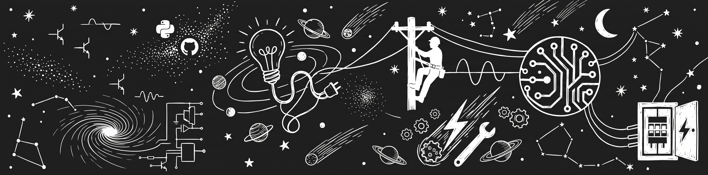

<div align="center">

  <!-- A SUA Imagem do Banner do LinkedIn -->
  

  <br><br>

  <!-- Digitação Animada Monocromática (Branco sobre Preto) -->
  <a href="https://git.io/typing-svg">
    
  </a>

</div>

<br>

---

### 🌌 Sobre Mim

```text
  💻 [Python & Automação] ---------------------> Dashboards interativos (Streamlit), scripts e análise de dados (Pandas, Plotly)
  🔧 [Hardware & Infraestrutura] -------------> Montagem, manutenção, diagnóstico de componentes e redes
  📐 [Engenharia & Projetos] ------------------> Graduando em Engenharia Elétrica com foco em tecnologia e CAD
